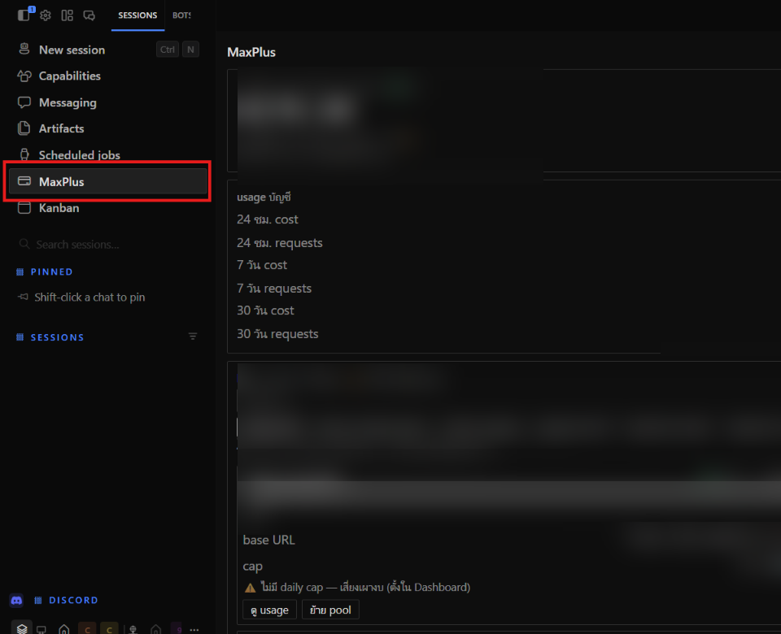
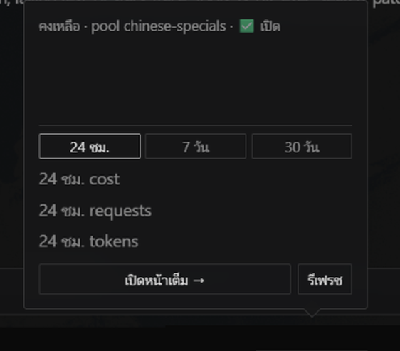

# MaxPlus Credit — Hermes Desktop Plugin

🌏 README in [ไทย](README.md)

View [MaxPlus](https://maxplus-ai.cc/invite/ZSPXWCJB) credit balance, usage statistics and per-pool API keys inside Hermes Desktop. Read-only plugin with full bilingual support (English / Thai).



Chip + summary popup (amounts masked in the sample):



📖 [Step-by-step install](docs/INSTALL.en.md) · [ติดตั้งทีละขั้น](docs/INSTALL.th.md)

## Install

**Install from Git** (Settings → Plugins) with repo: `Manchinn/hermes-maxplus-credit`,
or click:

```
hermes://plugin/install?repo=Manchinn/hermes-maxplus-credit&enable=1
```

(The link opens the confirm dialog — it never auto-installs.)

After install the file lands at `desktop-plugins/hermes-maxplus-credit/plugin.js`
— folder name is the repo name, while the plugin `id` inside is `maxplus-credit`.
Then enable **MaxPlus Credit** in Settings → Plugins (ships opt-in: `defaultEnabled: false`).

> Tokens are not in that folder — they live in the app's per-plugin storage keyed by `id`, so reinstall/delete keeps them safely.

## Usage

1. Open the **MaxPlus** page from the sidebar.
2. Toggle your preferred language anytime with `[ Auto | EN | TH ]` at the top right.
3. Add your **inference token** (`ccsk-…`) for balance + account usage.
4. Add your **management token** (`ccmk-…`) for the all-keys table (`keys:read` + `usage:read` scopes are sufficient).

The status-bar chip shows the balance (`MaxPlus $xx.xx`, polls every 60s) — click it for an instant **summary popup** without opening the full page.
